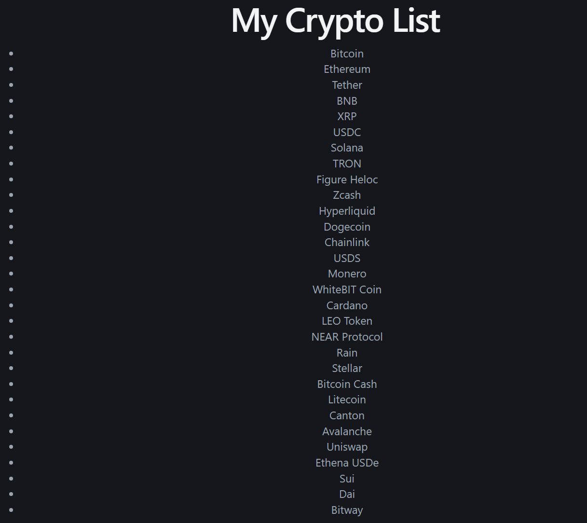
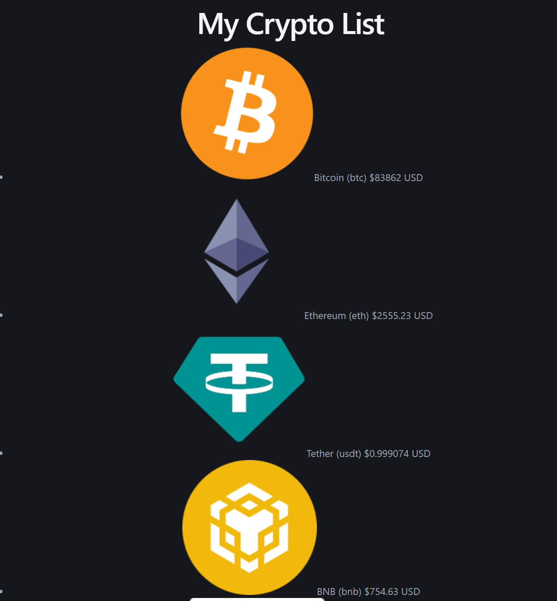
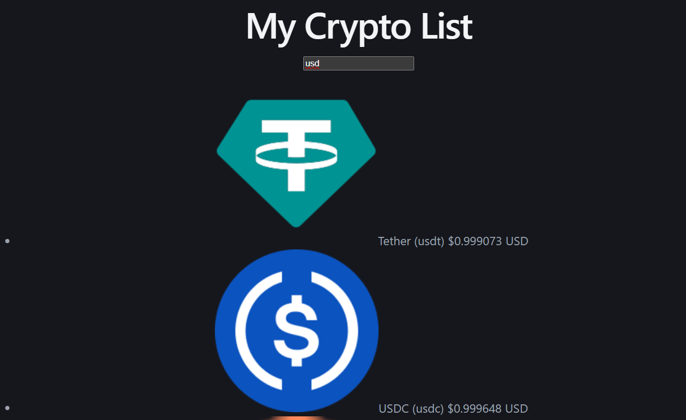
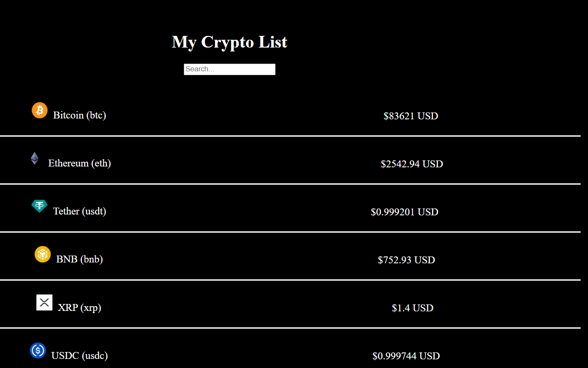
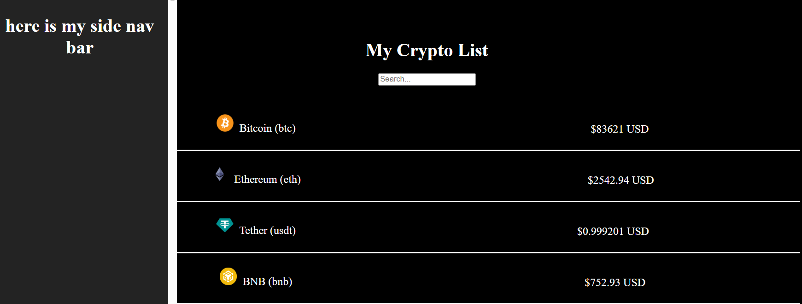

# Lab5: Crypto Hustle Lite

## Overview

Crypto Hustle Lite is an app that displays cryptocurrencies (their name, icon, and price in US dollars) using data you pull from an API, plus a search bar so users can find a specific currency.

## Step1: Query the CoinGecko API to get a list of coins

This step consist of making the first API call from the CoinGecko API and display the available list of coins.

## Step2: Create a CoinInfo component to display each coin's price and image

In this step we create a CoinInfo component and render dinamically the price and logo of each coin.

## Step3: Add a search bar with conditional rendering to filter coins

Add a search bar to filter a coin by they symbole.

## Step 4: Add CSS styling to make your page look unique

This step consist of adding styling on the page.

## Stretch Features

## Step 5: Add a side nav bar for extra crypto information

This step consist of adding a sidebar to get extra crypto information.

