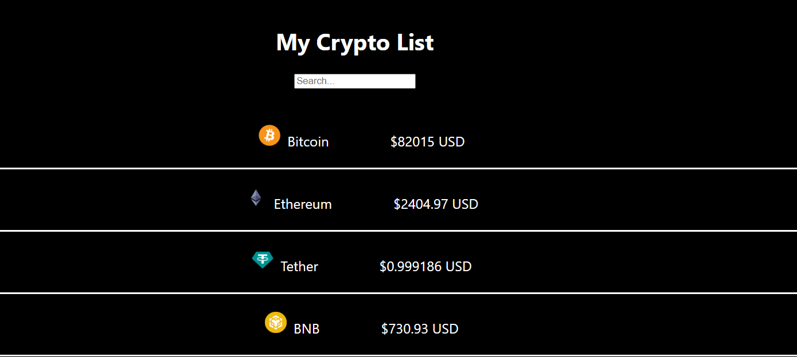
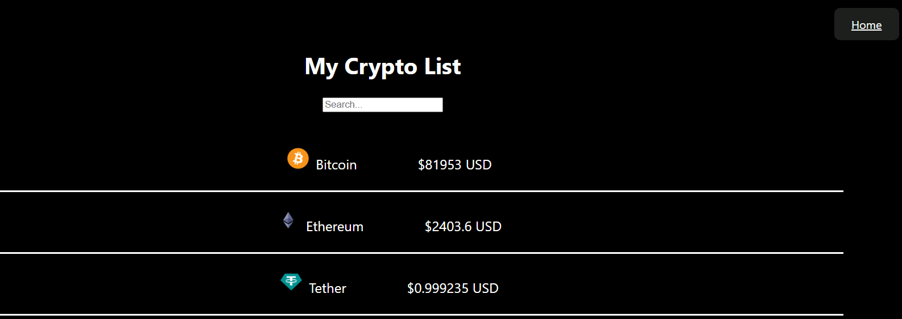
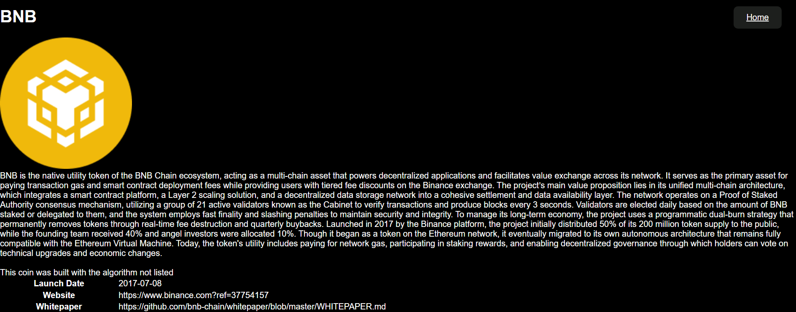
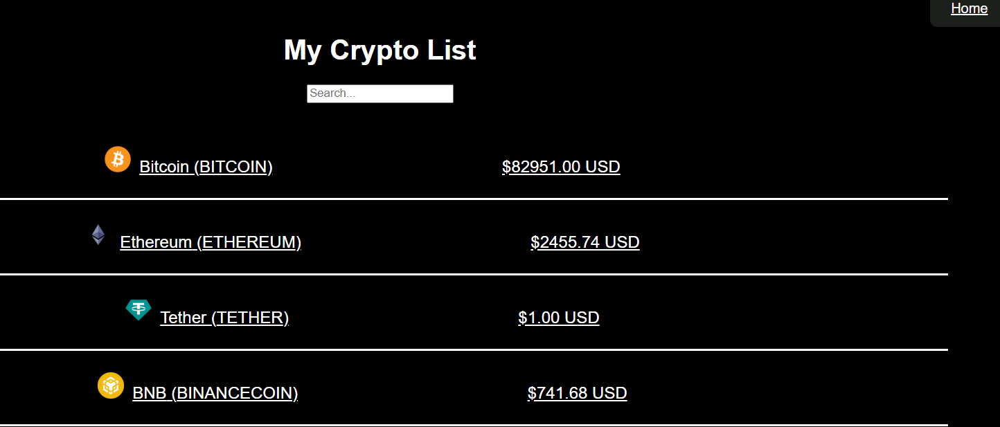

# LAb6: Crypto Hustle Pro

## Overview:

This lab consist of working with external API call CoinGecko API. This API will allow us to view current currency available and a detail of each currency.

## Step 0: Set up

This step consist of setting up our environment using the previous lab as the backbone of this Lab. So basically we are building this new lab on top of the previous lab.

## Step 1: Create routes for our web app

In this step we setup React Router and add a layout so that the home button appears in each page.

## Step 2: Create a DetailView for each coin

This step consist of displaying a detail of each coin when clicked. So the detail will show the a description, launch date, website, etc....

## Step3: Link to each DetailView by clicking a coin in the list

This step consist of making each coin linkable so when click is made it takes us to another page that display all detail info of the coin.

## Step 4: Create a "Not Found" page

Here we add a not found page so that whenever a user type or access the wrong coinbase url a not-found page will show to tell them that this page does not exist and Home button to take them back to the right page.

